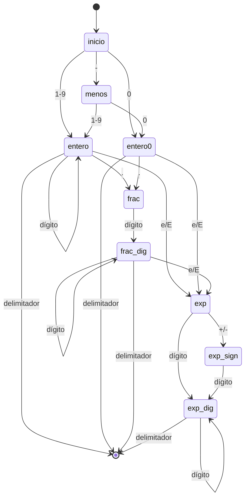

# Fase 1 — Análisis léxico (Semana 1, 26 oct – 1 nov 2026)

Implementación: `compiler/utf8.py`, `compiler/json_lexer.py`,
`compiler/xml_lexer.py`. Todo escrito a mano, sin `json.loads` ni
generadores de parsers. El lexer del propio esquema es el mismo
tokenizador JSON, porque el esquema es JSON (el metalenguaje se
gramatiza en la Fase 2, no aquí).

## 1. Alfabeto y tokens JSON

Alfabeto de entrada: bytes UTF-8. Espacio en blanco JSON: espacio,
tab, LF, CR. Cualquier otro byte de control fuera de cadena es error.

| Token | Lexema | Valor que entrega el lexer |
| --- | --- | --- |
| `{` `}` `[` `]` `:` `,` | un byte | None |
| STRING | `"..."` con escapes | cadena decodificada |
| NUMBER | ver gramática abajo | lexema original (nunca float) |
| TRUE / FALSE / NULL | `true` / `false` / `null` | True / False / None |

Guardar el número como lexema es una decisión deliberada, no un
detalle: en la Fase 3 los límites (`minimum`, `maximum`,
`multipleOf`) se comparan como cadenas decimales normalizadas, así
no se pierde precisión con enteros de 40 dígitos ni con `1e400`,
que un `double` no representa.

## 2. Gramáticas regulares

### Número JSON

```
número   ::= ["-"] entero [fracción] [exponente]
entero   ::= "0" | [1-9] dígito*
fracción ::= "." dígito+
exponente ::= ("e" | "E") ["+" | "-"] dígito+
dígito   ::= "0" | ... | "9"
```

AFD (estados: inicio, entero, entero0, fracción, dígitos-fracción,
exponente, signo-exponente, dígitos-exponente; solo entero,
entero0, dígitos-fracción y dígitos-exponente son de aceptación):



Caso que el AFD rechaza y que suele colarse: `01` (cero inicial
seguido de dígito), `1.`, `1e`, `1e+`, `-`, `.5`.

### Cadena JSON

```
cadena  ::= '"' (carácter | escape)* '"'
escape  ::= '\' ('"' | '\' | '/' | 'b' | 'f' | 'n' | 'r' | 't'
                 | 'u' hex hex hex hex)
carácter ::= cualquier byte UTF-8 válido excepto '"' , '\' y < 0x20
```

Reglas de `\u` que el lexer aplica (y que la mayoría de
tokenizadores caseros omiten):
- `\uD800..\uDBFF` (sustituto alto) exige inmediatamente
  `\uDC00..\uDFFF` (sustituto bajo); si no, error.
- Un sustituto bajo suelto es error.
- Un escape `\u` con menos de 4 hexadecimales es error.

### Literal

`true`, `false`, `null`: AFD trivial por prefijo, con la misma
regla de bloques que el número (ver §4): no se emite hasta que
aparece un delimitador o `finish()`.

### UTF-8

AFD con dos piezas de estado persistente: cuántos bytes de
continuación faltan y el rango permitido para el *primer* byte de
continuación. Ese rango es lo que rechaza por construcción:
- Lead `E0` → primer byte `A0..BF` (nada de sobrelargas).
- Lead `ED` → primer byte `80..9F` (nada de sustitutos UTF-16).
- Lead `F0` → primer byte `90..BF` (nada de sobrelargas).
- Lead `F4` → primer byte `80..8F` (nada > U+10FFFF).
- Leads `C0`, `C1`, `F5..FF` y bytes de continuación sueltos:
  error inmediato.

El mismo AFD está implementado en Python (`compiler/utf8.py`),
en C (`runtime/c/wdpda.c`) y en Rust (`runtime/rust/src/lib.rs`).

## 3. Tokenizador XML (subconjunto)

```
etiqueta   ::= '<' nombre (atributo)* '>'
             | '<' nombre (atributo)* '/>'
             | '</' nombre '>'
atributo   ::= nombre '=' ('"' texto '"' | "'" texto "'")
nombre     ::= [A-Za-z_][A-Za-z0-9_.-]*
texto      ::= cualquier secuencia sin '<' (hasta la siguiente etiqueta)
comentario ::= '<!--' texto '-->'
```

Decisiones de seguridad de la Semana 1:
- `<!DOCTYPE` se rechaza en el tokenizador (mitigación de XXE y
  de expansión de entidades por diseño; el proyecto usa XML sin
  DTD).
- El emparejamiento apertura/cierre (`<w>` con `</w>`) NO lo
  verifica el lexer: es trabajo del parser de la Fase 2 con la
  pila. El lexer solo garantiza etiquetas bien formadas
  sintácticamente.

## 4. Streaming por bloques: qué estado persiste

Esta es la parte que hace que la Semana 1 cumpla su hito
("mismo resultado partiendo la entrada en bloques de 1 byte"):

| Estado persistente | Dónde vive | Por qué |
| --- | --- | --- |
| Bytes sin tokenizar | `JsonTokenizer._buf` / `XmlTokenizer._buf` | Un token partido (cadena, número, etiqueta, texto) no se emite a medias |
| AFD UTF-8 | `Utf8Validator` (remaining, lo, hi) | Una secuencia multibyte partida no es error |
| Escape / `\u` en curso | escaneo de la cadena en curso | Un `\uD83D` partido entre bloques no se decide hasta ver el resto |
| Pila del runtime C/Rust | `wdpda_ctx_t` / `Context` | Un `[` abierto en un bloque se cierra en otro |

Regla que evita el error clásico de tokenizadores por bloques:
un número o un literal **no se emite** hasta que aparece un
delimitador o se llama a `finish()`. Si se emitiera `0` al ver el
primer byte, la entrada `01` (inválida) se tokenizaría por error
como dos números. Las pruebas `test_chunk_equivalence` y
`test_chunk_split_inside_escape_and_utf8` comprueban esto con
bloques de 1 y 7 bytes, incluidos escapes y caracteres multibyte
partidos.

## 5. Esqueleto del runtime (C y Rust)

API común (a congelar por escrito con el otro integrante, ver
`docs/ir.md`):
- `init(ctx, profundidad_max)` — profundidad acotada y configurable,
  tope absoluto 1024.
- `feed(ctx, bytes, n)` — por bloques, mismo resultado con bloques
  de 1 byte que con la entrada completa.
- `finish(ctx)` — OK solo si la pila está vacía, no quedó una
  cadena abierta ni una secuencia UTF-8 a medias.

Sin ninguna asignación dinámica: la pila es un arreglo fijo dentro
del contexto, que el llamador reserva. Error con offset en bytes
(0-based) y código (`DEPTH`, `MISMATCH`, `UNBALANCED`, `STRING`,
`UTF8`, `CONTROL`, `BYTE`).

Limitaciones honestas de la Semana 1 (no son bugs ocultos, son
trabajo de las semanas siguientes):
- El esqueleto C/Rust comprueba equilibrio de delimitadores,
  cadenas y UTF-8, pero NO valida números, literales ni la
  estructura completa de JSON (acepta, por ejemplo, `{,`).
  Eso lo hace el lexer + parser + WDPDA a partir de la Semana 2.
- El esqueleto C/Rust no valida pares sustitutos `\u` (el lexer
  Python sí); se unificará cuando el runtime integre el WDPDA.

## 6. Cómo correr las pruebas y el bench

```bash
python3 -m unittest discover -s tests -v
python3 bench/bench.py --size-kb 64 --reps 3
gcc -std=c11 -Wall -Wextra -Werror -O2 -o /tmp/wdpda_cli runtime/c/wdpda.c runtime/c/main.c
cargo test --manifest-path runtime/rust/Cargo.toml
cargo clippy --manifest-path runtime/rust/Cargo.toml -- -D warnings
```

Resultados medidos en esta máquina de desarrollo (Semana 1,
payload sintético de ~67 KB, mediana de 3 repeticiones; cifras
de referencia, NO cifras del informe final, que se medirá en
una máquina fija con la metodología completa):
- Tokenizador Python: ~1,08 MB/s.
- Runtime C: ~20,7 MB/s (bloque 1), ~35,9 MB/s (bloque 64),
  ~36,4 MB/s (bloque 4096).
- Ciclos/byte: N/A (`perf` no disponible aquí; se medirá con
  `perf stat` en la máquina del informe, no se inventa el número).

La comparación C contra Python NO es una "mejora": son piezas
distintas (tokenizador completo contra esqueleto estructural).
La línea base DOM + validador genérico llega con el validador
real, en las semanas 2-3.
