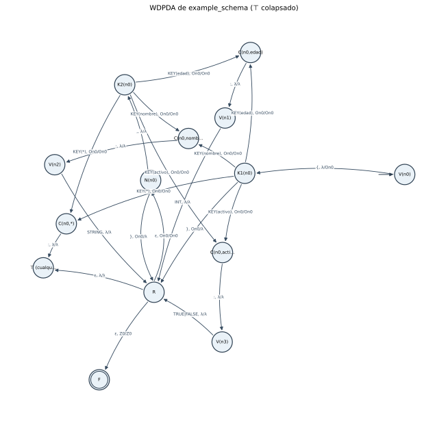
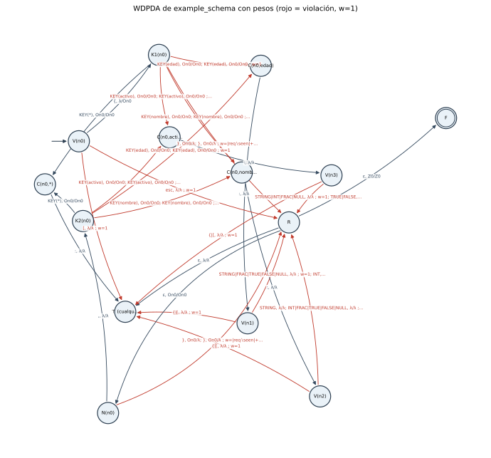

# Fase 4 — El autómata de pila ponderado (WDPDA)

Código: `compiler/wdpda.py` (construcción e IR), `compiler/formal.py` (δ
explícito, determinismo, ejecución paso a paso), `compiler/engine.py`
(semántica ejecutable). Diagramas: `docs/diagramas/` (JFLAP, SVG, DOT,
Mermaid).

---

## 1. Por qué un autómata **de pila** (y no uno finito)

El lenguaje de los documentos JSON bien formados **no es regular**.
Demostración con el lema de bombeo para lenguajes regulares: supongamos
que lo fuera, con constante de bombeo `p`. Tomamos
`w = [^p ]^p` (p corchetes que abren y p que cierran), que es JSON
válido y tiene `|w| ≥ p`. Toda descomposición `w = xyz` con `|xy| ≤ p`,
`|y| ≥ 1` deja `y` formado solo por `[`. Bombeando, `xy²z` tiene más `[`
que `]`, así que no es JSON. Contradicción: hace falta memoria no acotada
para emparejar delimitadores, es decir, **una pila**.

En cambio, JSON **sí es libre de contexto** (ver la gramática LL(1) de
`docs/fase2-sintaxis.md`) y lo reconoce un autómata de pila
**determinista**: en todo momento el siguiente token y el tope de la pila
deciden la única transición posible.

Más aún: la pila de JSON/XML es **visible** (*visibly pushdown*, Alur y
Madhusudan, 2004). El alfabeto se parte en llamadas `Σc = { {, [, <e> }`
que siempre apilan, retornos `Σr = { }, ], </e> }` que siempre desapilan
y símbolos internos `Σi` (claves, escalares, `:` y `,`) que nunca tocan la
pila. Esa propiedad es la que hace posible el producto de autómatas de la
sección 6.

## 2. Definición formal

```
M = (Q, Σ, Γ, δ, q0, Z0, F, w)
```

| Componente | En este proyecto |
| --- | --- |
| `Q` | Estados construidos por nodo del esquema: `V(n)`, `K1(n)`, `K2(n)`, `C(n,k)`, `N(n)`, `A1(n)`, `A2(n)`, `M(n)`, más `R` (retorno) y `F` (aceptación). Ver la tabla de la sección 3. |
| `Σ` | Tokens **refinados** que entrega el transductor léxico (AFD sobre bytes UTF-8): `{ } [ ] : ,`, `KEY(k)` para cada clave distinguida `k` (más `KEY(*)` para las demás), y los escalares `STRING`, `INT`, `FRAC`, `TRUE`, `FALSE`, `NULL` con su **guarda** (resultado de los AFD de `enum`/`pattern`, del contador de longitud y de la comparación decimal). |
| `Γ` | `Z0`, y un símbolo `On` / `An` por cada nodo objeto / arreglo del esquema, que lleva sus **registros acotados**: máscara `seen` de 64 bits, contador de miembros o elementos (saturado), estado de `uniqueItems`. |
| `δ` | `Q × (Σ ∪ {ε}) × Γ → Q × Γ*`. Construcción composicional (sección 3). |
| `q0` | `V(raíz)` |
| `Z0` | símbolo inicial de pila |
| `F` | `{F}`: se acepta al leer todo el documento y volver a `Z0` |
| `w` | `δ → 𝕋 = (ℕ ∪ {+∞}, min, +, +∞, 0)`, el **semianillo tropical** |

**Γ es finito.** Cada símbolo `On` lleva una máscara de `k ≤ 64` bits y
contadores saturados en `max(minItems, maxItems, …) + 1`. Γ es finito
porque los registros son acotados. Si se "expandieran" en el control
finito, Γ tendría `|nodos| · 2^k · (c+1)` símbolos. Por eso se guardan
codificados en binario en el marco de la pila y no como estados
explícitos. Esta es la diferencia entre la categoría **(b)** (registros
acotados) y una explosión de estados.

### 2.1 Los pesos: semianillo tropical

`𝕋 = (ℕ ∪ {+∞}, ⊕ = min, ⊗ = +, 0̄ = +∞, 1̄ = 0)`.

- Cada transición tiene peso `w(t) ∈ {0, 1}`: **0** si respeta el
  esquema y **1** si es una violación (tipo incorrecto, clave adicional
  prohibida, valor fuera de rango…). Las transiciones de cierre `}` pesan
  `|req ∖ seen|` (una unidad por propiedad requerida que falta).
- El peso de una ejecución es la suma (⊗ = +) de sus transiciones, es
  decir, **el número de violaciones**.
- El peso de una entrada es el mínimo (⊕ = min) sobre sus ejecuciones.
  Sin combinadores hay **una sola** ejecución (determinismo), así que el
  peso es simplemente el número de violaciones.
- **Entrada mal formada**: no existe ninguna ejecución, y el mínimo de un
  conjunto vacío es el cero del semianillo, `+∞`.

En resumen: **0 = válido, k = k violaciones, +∞ = mal formado.** Gracias
a esto el WDPDA es *total* sobre el JSON bien formado. Tras una violación
de tipo salta al subautómata genérico `⊤` (con peso 1) y sigue validando
el resto del documento, así que reporta **todas** las violaciones, cada
una con su ruta.

Con `anyOf` hay una ejecución por rama, y `⊕ = min` da exactamente la
semántica de `anyOf`: el documento es válido si **alguna** rama pesa 0.
El peso reportado es el de la mejor rama, una medida de *distancia de
conformidad*.

**Costo estático (fallo temprano).** Además del peso de violación, cada
comprobación tiene un costo estimado en compilación (`COST` en
`wdpda.py`: tipo 1, longitud 1, `required` 1, enum 2, rango 2,
`multipleOf` 4, `pattern` 3 + estados/8, `uniqueItems` 8). Las
comprobaciones de cada nodo se ordenan de menor a mayor costo, de modo
que en modo `--fail-fast` la primera que falla es la más barata. El
campo `checks` de cada nodo del IR guarda ese orden.

## 3. Construcción composicional (por nodo del esquema)

Para cada nodo `n` del esquema se generan sus estados y transiciones; los
hijos se enlazan por su `V(hijo)`. `⊤` es el nodo "cualquier JSON".

| Estado | Significado |
| --- | --- |
| `V(n)` | se espera un valor que debe cumplir el nodo `n` |
| `K1(n)` | se leyó `{` de un objeto de `n`: viene una clave o `}` |
| `K2(n)` | se leyó `,` en un objeto de `n`: viene una clave |
| `C(n,k)` | se leyó la clave `k` (o `*`): viene `:` |
| `N(n)` | se leyó un miembro: viene `,` o `}` |
| `A1(n)` / `A2(n)` | tras `[` / tras `,` en un arreglo de `n` |
| `M(n)` | se leyó un elemento: viene `,` o `]` |
| `R` | retorno: decide con el **tope de la pila** (transición ε) |
| `F` | aceptación |

Plantilla de transiciones (`w` = peso):

```
V(n)   --{ / push On--------------------------> K1(n)    w=0  si object ∈ type(n)
V(n)   --{ / push O⊤--------------------------> K1(⊤)    w=1  si no (violación de tipo)
V(n)   --STRING [⊨ checks(n)]-----------------> R        w=0
V(n)   --STRING [⊭ checks(n)]-----------------> R        w=#fallos
K1(n)  --KEY(k), On/On' {seen ∪= {k}}---------> C(n,k)   w=0  (k ∉ seen)
K1(n)  --KEY(k) [k ∈ seen]--------------------> C(n,k)   w=1  (clave duplicada)
C(n,k) --:------------------------------------> V(hijo_k)
C(n,*) --:------------------------------------> V(additional) | V(⊤) con w=1 si additionalProperties=false
N(n)   --,------------------------------------> K2(n)
N(n)   --}, On/λ [req ⊆ seen]-----------------> R        w=0
N(n)   --}, On/λ [¬(req ⊆ seen)]--------------> R        w=|req∖seen|
R      --ε, On/On-----------------------------> N(n)     (volver al objeto)
R      --ε, An/An-----------------------------> M(n)     (volver al arreglo)
R      --ε, Z0/Z0-----------------------------> F
```

**`R` y el tope de la pila.** Al terminar un valor no se sabe en qué
contexto se estaba (dentro de qué objeto o arreglo); eso lo sabe la pila.
`R` lee el tope **sin consumir entrada** (ε) y salta a `N(n)` o a `M(n)`.
Es determinista porque `R` no tiene transiciones que lean entrada.

**Recursión (`$ref`).** Un esquema recursivo (árbol) no genera infinitos
estados: `V(nodo)` aparece una sola vez y la recursión del documento la
lleva la pila. Por ejemplo, `arbol.json` tiene 3 nodos y 22 estados, y
valida árboles de cualquier profundidad (hasta el límite configurado).

### 3.1 Ejemplo completo: el esquema del MVP

```json
{ "type": "object",
  "properties": { "edad": {"type": "integer"}, "nombre": {"type": "string"},
                  "activo": {"type": "boolean"} },
  "required": ["edad", "nombre"] }
```

Resultado: **21 estados, 92 transiciones, Γ = {Z0, O⊤, A⊤, On0}**,
determinista. δ completo: `docs/diagramas/ejemplo/example_schema_delta.txt`.



Con pesos (en rojo, las transiciones de violación):


Traza de `{"edad":"25","nombre":"Ana"}`:

| Token | Transición | Pila | Peso |
| --- | --- | --- | --- |
| `{` | `V(n0) → K1(n0)`, push `On0` | `Z0 On0{seen=∅}` | 0 |
| `KEY(edad)` | `K1(n0) → C(n0,edad)`, seen∪={edad} | `Z0 On0{edad}` | 0 |
| `:` | `C(n0,edad) → V(n1)` | | 0 |
| `STRING "25"` | `V(n1) → R` **[tipo]** | | **1** |
| ε | `R → N(n0)` (tope `On0`) | | 1 |
| `,` | `N(n0) → K2(n0)` | | 1 |
| `KEY(nombre)` | `K2(n0) → C(n0,nombre)` | `Z0 On0{edad,nombre}` | 1 |
| `:` `STRING` | `C → V(n2) → R` | | 1 |
| ε `}` | `R → N(n0)`; `N(n0) → R` [req ⊆ seen], pop | `Z0` | 1 |
| ε | `R → F` (tope `Z0`) | | **1** |

Resultado: **INVALID, peso 1**, error `TYPE` en `/edad` (byte 8). La web
muestra esta misma traza paso a paso (pestaña *Validar*).

## 4. Verificación automática del determinismo

`compiler/formal.py::check_determinism` comprueba sobre δ:

1. A lo sumo una transición por `(q, a, X, guarda)`. Las guardas
   complementarias (`⊨`/`⊭`, `k∉seen`/`k∈seen`, `i=j`/`i≥p`) **parten**
   el símbolo: refinan el alfabeto en lugar de crear no determinismo.
2. Si hay una transición ε desde `(q, X)`, no hay ninguna que lea
   entrada desde `(q, X)`.
3. Una transición que no mira la pila (λ) no coexiste con otra que sí
   la mira para el mismo `(q, a)`.

Los 10 esquemas de prueba dan `deterministic = true`
(`tests/test_fases.py::test_delta_is_deterministic`).

## 5. Minimización

1. **Nodos del esquema (Moore).** `minimize_nodes` refina particiones
   sobre el grafo de nodos: dos nodos son equivalentes si tienen las
   mismas restricciones locales y sus hijos, posición a posición, están
   en bloques equivalentes. Funciona con ciclos (`$ref` recursivo)
   porque refina una partición en lugar de comparar árboles. Ejemplo:
   tres propiedades `{"type":"integer","minimum":0}` pasan de 4 nodos a
   2 (`test_node_minimization_merges_equivalent_subschemas`); en
   `evento.json`, de 13 a 9.
2. **AFD auxiliares (Moore).** Cada trie de claves/enum y cada AFD de
   `pattern` se minimiza (`DFA.minimize`). Ejemplos:
   `^[^@]+@[^@]+\.[a-z]{2,6}$` pasa de 85 a 25 estados; `xs:date` (con
   años bisiestos) de 85 a 43.
3. **Alfabeto (clases de bytes).** Los bytes que ninguna transición
   distingue comparten columna en la tabla densa (`DFA.byte_classes`):
   tablas de `estados × clases` en lugar de `estados × 256`.

## 6. Categoría (c): producto de autómatas para combinadores

`allOf`, `anyOf`, `oneOf`, `not`, `if/then/else`, `contains` y
`dependentSchemas` validan **la misma instancia** contra varios
subautómatas. Problema teórico: **los lenguajes libres de contexto NO son
cerrados bajo intersección** (`{aⁿbⁿcᵐ} ∩ {aᵐbⁿcⁿ} = {aⁿbⁿcⁿ}`, que no es
libre de contexto), así que en general el producto de dos PDA no es un
PDA.

Lo que lo salva aquí es que **todos los componentes son autómatas de pila
visibles con la misma partición del alfabeto**: todos apilan en `{`/`[`
y desapilan en `}`/`]` **al mismo tiempo**. Los lenguajes de pila visible
**sí** son cerrados bajo intersección, unión y complemento, y el producto
se construye con una **única pila** cuyo símbolo es la tupla de símbolos
de los componentes (Alur y Madhusudan, 2004).

Implementación: los **carriles** (`Lane` en `engine.py`). En cada nivel de
la pila hay un vector de carriles; cada carril es una copia del
subautómata de un nodo con sus registros, y todos leen el mismo token. Al
cerrar el valor, los pesos se combinan con el semianillo:

| Combinador | Combinación de pesos de las ramas `t₁…tₖ` |
| --- | --- |
| `allOf` | `t₁ ⊗ … ⊗ tₖ = Σ tᵢ` |
| `anyOf` | `t₁ ⊕ … ⊕ tₖ = min tᵢ` |
| `oneOf` | 0 si exactamente un `tᵢ = 0`; si no, `min tᵢ` (ninguno) o 1 (varios) |
| `not` | 1 si `t = 0`, 0 si `t > 0` (complemento: VPA cerrado) |
| `if/then/else` | `t_then` si `t_if = 0`; si no, `t_else` (selección diferida al cerrar) |
| `contains` | cuenta los elementos con `t = 0` (contador acotado) |
| `dependentSchemas` | `t` solo si la clave estaba en `seen` (verificación diferida) |

**Riesgo de explosión al determinizar.** Determinizar un VPA cuesta en el
peor caso `2^O(n²)` estados. Aquí la determinización se hace **en tiempo
de ejecución y acotada**: como mucho `max_lanes = 64` carriles por nivel
y 4096 en toda la pila (`DEFAULT_LIMITS`). El compilador calcula el ancho
de cada nodo (`_lane_widths`) y rechaza los esquemas que superan el límite
("riesgo de explosión al determinizar"). La memoria queda en `O(d · B)`.

Los errores de un carril **especulativo** (dentro de una rama de
`anyOf`/`oneOf`/`not`/`if`/`contains`) no se reportan sueltos, porque la
rama puede no ser la elegida. Solo se reporta el resultado de la
combinación (p. ej. `ANY_OF: ninguna alternativa es válida (mejor rama:
1 violaciones)`).

## 7. Categoría (c): lo que NO es libre de contexto

**`uniqueItems`.** Sea `U = { [w₁, …, wₙ] : wᵢ ≠ wⱼ si i ≠ j }`.
**Ningún autómata de pila visible (el modelo del validador de una pasada)
reconoce `U`.** La demostración es un argumento de conjunto engañador
(Myhill–Nerode):

1. En un autómata de pila visible, la altura de la pila después de leer
   un prefijo está fijada por el anidamiento: dentro del arreglo de nivel
   1 la pila tiene **un** símbolo sobre `Z0`. Por eso, después de leer
   `[x₁, …, xₖ`, la configuración `(q, γ)` pertenece a un conjunto
   **finito** `Q × Γ`.
2. Para cada conjunto finito `S` de cadenas, sea `p_S` el prefijo
   `[` seguido de los elementos de `S` separados por comas. Si `S ≠ T`,
   tomamos `y ∈ S ∖ T` (o al revés): `p_S , y ]` tiene un duplicado y no
   está en `U`, mientras que `p_T , y ]` sí está en `U`. Entonces `p_S` y
   `p_T` deben llevar a configuraciones distintas.
3. Hay infinitos conjuntos `S` y finitas configuraciones a profundidad 1:
   contradicción.

Por lo tanto, `uniqueItems` exige memoria proporcional al número de
elementos; con registros acotados no se puede decidir de forma exacta.
(Observación: con exactamente **dos** elementos, `x ≠ y` sí es libre de
contexto. Lo que falla es recordar un conjunto no acotado en una pila
cuya altura la fija el anidamiento).

Estrategia: **verificación diferida con un registro acotado**. Para cada
elemento se calcula, en streaming, un hash canónico de 64 bits:

- las cadenas se hashean sobre los bytes decodificados (`"A"` ≡
  `"A"`);
- los números se hashean sobre su forma normalizada (`1.0` ≡ `1`);
- los objetos combinan sus miembros con una suma conmutativa (el orden
  de las claves no importa);
- los arreglos combinan sus elementos en orden.

Esos hashes van a una tabla abierta de capacidad fija (4096 elementos por
arreglo). La probabilidad de colisión es ≈ `n²/2⁶⁵`, despreciable para
arreglos acotados. Si se supera la capacidad, el resultado es `LIMIT`
(nunca una respuesta incorrecta en silencio).

**`pattern`.** Es regular (subconjunto sin retrorreferencias ni
*lookaround*). Se clasifica en (c) porque **determinizar** la regex puede
explotar: `(a|b)*a(a|b){n}` necesita `2^(n+1)` estados. El compilador
tiene un tope (4096) y rechaza el patrón con un mensaje claro
(`test_minimization_and_explosion`).

## 8. Complejidad

| Recurso | Cota | Por qué |
| --- | --- | --- |
| Tiempo de validación | `O(n · B)` | cada byte se procesa una vez: un paso de AFD por AFD activo; cada token, `O(B)` trabajo de carriles. Con `B` acotado (sin combinadores, `B = 1`), **`O(n)`**. |
| Memoria | `O(d · B)` | un marco por nivel de anidamiento, con `B` carriles de tamaño fijo. Sin AST. |
| Asignaciones | 0 | contexto de tamaño fijo, decidido en compilación |
| Compilación | `O(|esquema|)` + AFD | salvo la determinización de `pattern` (acotada por el tope) |

Comprobación experimental (bombeo `u·vᵏ·x·yᵏ·z`, `bench/RESULTADOS.md`):
el tiempo crece de forma lineal con `k` (k = 1000: 0,067 ms; k = 10 000:
0,69 ms) y la memoria del WDPDA es constante. La línea base DOM crece en
asignaciones (50 002 con k = 10 000) y en memoria pico (1,8 MB).
